# AUXILIUM architecture

> A3 landscape reference. The diagram is intentionally limited to the current implementation: OSM pedestrian data, Mapillary/Gemini evidence, the routing API, the React map, and optional Firebase services.

```mermaid
%%{init: {"flowchart": {"curve": "linear", "nodeSpacing": 28, "rankSpacing": 42}, "theme": "base", "themeVariables": {"fontFamily": "Arial", "fontSize": "15px", "primaryTextColor": "#17212b", "lineColor": "#52606d", "clusterBkg": "#f5f7f8", "clusterBorder": "#9aa5b1"}}}%%
flowchart TB

  subgraph HIGH[HIGH LEVEL · AUXILIUM]
    direction LR
    DATA[Data and evidence] --> ROUTE[Accessibility-aware routing]
    DATA --> APP[Map and review application]
    ROUTE --> APP
    APP <--> CLOUD[Optional Firebase Auth and Firestore]
  end

  subgraph MID[MID LEVEL · SYSTEM COMPONENTS]
    direction LR
    subgraph PIPE[Data pipeline]
      OSM[OSM extraction<br/>pedestrian_paths.geojson]
      MAP[Mapillary ingestion]
      AI[Gemini observations<br/>needs_review]
      MATCH[Validation, path matching<br/>review queue and reports]
      OSM --> MATCH
      MAP --> AI
      AI --> MATCH
    end

    subgraph BACK[Backend]
      API[HTTP routing API<br/>GET /api/health<br/>POST /api/routes]
      GRAPH[Pedestrian graph<br/>profile-aware costs]
      API --> GRAPH
    end

    subgraph FRONT[Frontend]
      REACT[React application]
      MAPVIEW[MapView<br/>Leaflet map, paths, evidence, routes]
      PROFILE[Mobility profile and route summary]
      REVIEW[Evidence popup and review actions]
      REACT --> MAPVIEW
      REACT --> PROFILE
      MAPVIEW --> REVIEW
    end

    MATCH -->|canonical GeoJSON and review artifacts| FRONT
    MATCH -->|pedestrian_paths.geojson| GRAPH
    FRONT -->|route request| API
    API -->|route response| FRONT
  end

  subgraph LOW[LOW LEVEL · IMPLEMENTATION DETAILS]
    direction LR
    subgraph LPIPE[Pipeline modules]
      EXTRACT[data-pipeline/extract_osm.py<br/>bbox or Geofabrik extraction]
      INGEST[data-pipeline/ingest_mapillary.py<br/>Mapillary API and optional Gemini]
      QUALITY[data-pipeline/accessibility_quality.py<br/>50 m matching, validation, CSV queue]
      AIPIPE[data-pipeline/mangalore_ai_pipeline.py<br/>inventory, batches, publishing]
      EXTRACT --> QUALITY
      INGEST --> QUALITY
      AIPIPE --> QUALITY
    end

    subgraph LBACK[Routing modules]
      LOAD[load_graph and GeoJSON loader]
      BUILD[PedestrianGraph construction<br/>nodes, directed edges, attributes]
      COST[Profile costs<br/>general · wheelchair · walking_difficulty]
      PATH[Shortest path and alternatives]
      VALID[Route validation and serialization]
      LOAD --> BUILD --> COST --> PATH --> VALID
    end

    subgraph LFRONT[Frontend modules]
      APPJS[frontend/src/App.jsx<br/>session, profile, route summary]
      MVJS[frontend/src/components/MapView.jsx<br/>selection, fetch, rendering]
      AUTH[frontend/src/services/auth.js<br/>Google Auth and profiles]
      REV[frontend/src/services/reviews.js<br/>Firestore review sync and local fallback]
      FB[frontend/src/lib/firebase.js<br/>environment-based configuration]
      APPJS --> MVJS
      APPJS --> AUTH
      MVJS --> REV
      AUTH --> FB
      REV --> FB
    end

    OSMFILE[data-pipeline/output/pedestrian_paths.geojson]
    EVIDENCE[data-pipeline/output/mangalore_mapillary_accessibility.geojson]
    OSMFILE --> LOAD
    EVIDENCE --> MVJS
    QUALITY --> EVIDENCE
    QUALITY --> MATCH
    API --> VALID
  end

  classDef high fill:#e8f1f5,stroke:#315a6d,stroke-width:2px,color:#17212b;
  classDef mid fill:#f4efe5,stroke:#8a6a3b,stroke-width:1.5px,color:#17212b;
  classDef low fill:#edf3ea,stroke:#55734e,stroke-width:1.5px,color:#17212b;
  classDef store fill:#f1edf6,stroke:#72558c,stroke-width:1.5px,color:#17212b;
  classDef endpoint fill:#f7ece8,stroke:#9a5143,stroke-width:1.5px,color:#17212b;

  class DATA,ROUTE,APP,CLOUD high;
  class PIPE,BACK,FRONT,OSM,MAP,AI,MATCH,REACT,MAPVIEW,PROFILE,REVIEW,GRAPH mid;
  class LPIPE,LBACK,LFRONT,EXTRACT,INGEST,QUALITY,AIPIPE,LOAD,BUILD,COST,PATH,VALID,APPJS,MVJS,AUTH,REV,FB low;
  class OSMFILE,EVIDENCE store;
  class API endpoint;
```

## Runtime flow

1. OSM extraction produces pedestrian path GeoJSON. Mapillary ingestion and optional Gemini analysis produce evidence observations marked for review.
2. The quality module validates evidence, associates observations with nearby OSM segments using the fixed 50 metre threshold, and writes the matching report and review queue.
3. The backend loads the canonical OSM GeoJSON into an in-memory pedestrian graph. It builds directed edges with OSM attributes and applies the selected mobility profile during shortest-path search.
4. The frontend loads the published OSM and evidence GeoJSON, lets a user choose two map points, and calls `POST /api/routes` through the Vite proxy.
5. The backend returns complete route geometries, alternatives, distance, duration, warnings, and path IDs. `MapView` renders the selected route, alternatives, evidence markers, and OSM overlay.
6. Human review actions are stored locally for demo mode. When Firebase is configured and the user is authenticated, review decisions synchronize to Firestore under the authenticated user.

## Main contracts

| Boundary | Contract |
| --- | --- |
| Pipeline → frontend | `mangalore_mapillary_accessibility.geojson`, `pedestrian_paths.geojson`, review queue and matching report |
| Frontend → backend | `POST /api/routes` with `start`, `destination`, `profile`, and `alternatives` |
| Backend → frontend | Route GeoJSON geometry, distance, duration, warnings, accessibility score, and OSM path IDs |
| Frontend → Firebase | Authenticated user profile and one review document per evidence ID |

## Profile behavior

- **General:** normal pedestrian routing across valid OSM pedestrian edges; unknown accessibility tags do not exclude edges.
- **Wheelchair:** excludes confirmed barriers and cautiously penalizes unknown or difficult conditions.
- **Walking support:** normal pedestrian routing with additional cost for stairs, steep inclines, and difficult surfaces.

Gemini and Mapillary observations remain evidence for human review. They do not automatically become verified barriers or accessibility facts.
